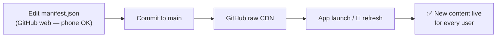

# शिष्यता रोडमेप · Discipleship Roadmap

**A Hindi/English Android app that helps pastors and believers grow through a
structured Bible-study curriculum — from foundational truth to mature, grounded faith.**

This repository is the app's **live content backbone**: it hosts the
`manifest.json` the app fetches on every launch, so teaching content
(text · audio · video) can be added or updated **without ever rebuilding or
re-releasing the APK**.

---

## The App

| Tab | What it shows |
|---|---|
| **उद्देश्य** | The aim — God-centred Bible-study vision with scripture references |
| **विश्वास** | Statement of faith — 12 declarations in 3 sections |
| **रोडमेप** | The curriculum — 3 parts (परमेश्वर-केन्द्रित · बाइबल की पुस्तकें · व्यावहारिक मसीही जीवन) with tap-to-track progress (⬜ → 🟡 → ✅) |
| **प्रगति** | Progress report across every topic |

- Install: APK side-load today · **Google Play Store coming soon**
- Video/audio/text play **inside the app** — users are never redirected
  to YouTube or a browser

---

## How content updates work



1. Upload the teaching to YouTube as **Unlisted** → copy the link/ID
2. Edit [`manifest.json`](./manifest.json) → add the entry → **Commit**
3. Every user has it within **~5 minutes** — no APK rebuild, no Play
   Store release, no reinstall

---

## manifest.json format

One object: each key is a stable topic slug, each value may contain any
combination of fields:

```json
{
  "roadmap.overview": {
    "youtube": "3gPo9wHzNUc",
    "text": "परिचय का पाठ…"
  },
  "a.study-of-god.knowing-about-god-vs-knowing-god": {
    "text": "लेख…",
    "audio": "https://example.com/audio.mp3",
    "video": "https://example.com/video.mp4",
    "youtube": "3gPo9wHzNUc"
  }
}
```

| Field | Meaning |
|---|---|
| `text` | Article shown in the in-app reader |
| `audio` | Direct MP3 URL → in-app mini-player |
| `video` | Direct MP4 URL → in-app player (preferred when available) |
| `youtube` | YouTube ID **or** full URL → in-app embed (used when no direct `video`) |

Special key **`roadmap.overview`** powers the **🎬 📖 परिचय** pill on the
roadmap screen. Video resolution order: `video` → `youtube` → no player.

Omit any field you don't have yet — topics show a grey "coming soon"
badge until their content exists.

---

## Repository contents

| File | Purpose |
|---|---|
| [`manifest.json`](./manifest.json) | Live app content — fetched at every app launch |
| [`CHANGELOG.md`](./CHANGELOG.md) | APK release notes |

> ⚠️ Keep this repository **public** (the app fetches it without
> authentication) and keep **only content files** here — never app source,
> keys, or credentials.

---

## Security notes

- All manifest content is **escaped** before rendering — a modified
  manifest can change what users *see*, never execute code in the app
- Fetch is **HTTPS-only**; the APK is release-signed with minimal permissions
- Enable **2FA** on the GitHub account that owns this repository

---

## Links

- 🎥 YouTube: [@ministrieschristalone](https://www.youtube.com/@ministrieschristalone)
- 📖 Ministry: Christ Alone Ministries
